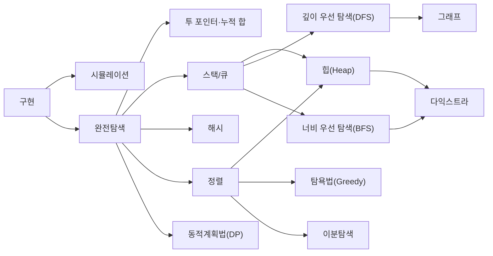

# 온톨로지와 풀이 범위

온톨로지(`app/tutor/knowledge`)는 사람이 다듬은 정적 그래프다. 주제 15개, 기법, 패턴, 함정, 구현 기술, 입력 크기 경험칙을 담고, 모델이 노드를 새로 만들지 않는다.

## 성격

- 노드 종류: 기법(Technique), 패턴(문제 글의 단서와 기법을 잇는 것), 함정(Pitfall), 구현 기술(Skill), 입력 크기 경험칙(SizeRule). 주제는 `common/scope.py`에 15종으로 정해져 있다.
- 대상 수준은 회사 코딩테스트 1–2단계다. 대회용 기법은 넣지 않는다.
- 사용자 쪽 기록(문제의 패턴, 제출이 밟은 함정)은 온톨로지가 아니라 SQLite에 있다.

## 주제 15개

| id | 이름 | 허용 기법(요약) |
|---|---|---|
| `hash` | 해시 | 딕셔너리, 집합, 개수 세기 |
| `stack_queue` | 스택/큐 | 스택, 큐, 덱, 단조 스택 |
| `heap` | 힙(Heap) | 우선순위 큐, 두 힙 |
| `sort` | 정렬 | 내장 정렬, 비교 기준 |
| `brute_force` | 완전탐색 | 전수 반복, 순열·조합, 백트래킹 |
| `greedy` | 탐욕법(Greedy) | 정렬 뒤 고르기, 구간 고르기 |
| `dp` | 동적계획법(Dynamic Programming) | 1·2차원 표, 점화식, 배낭 |
| `dfs` | 깊이 우선 탐색(DFS) | 재귀·스택 DFS, 연결 요소 |
| `bfs` | 너비 우선 탐색(BFS) | 큐 BFS, 격자 최단 거리 |
| `dijkstra` | 다익스트라 | 가중치 최단 경로 |
| `binary_search` | 이분탐색 | 하한·상한, 답을 정해 놓고 확인 |
| `graph` | 그래프 | 유니온 파인드, 위상 정렬, 최소 신장 트리, 플로이드 |
| `two_pointer` | 투 포인터·누적 합 | 투 포인터, 슬라이딩 윈도우, 누적 합 |
| `simulation` | 시뮬레이션 | 격자 이동·회전, 상태 바꾸기 |
| `implementation` | 구현 | 문자열, 규칙 순서 적용, 날짜·진수 계산 |

- 블록 설계 프롬프트에 15종 목록을 넣는다. 15종으로 못 풀면 가장 가까운 주제와 `out_of_scope`를 함께 낸다. 화면의 주제 이름과 순서도 이 15개를 쓴다.

## 선수 관계

선수 주제에서 뒤의 주제로 화살표를 그렸다. 선수가 없는 주제는 `implementation` 하나이고, 15개 주제가 모두 이 그래프에 나온다. 엣지는 16개다.

- 이 관계를 쓰는 곳은 피드백 프롬프트 한 곳이다. 제출이 실패했을 때 선수 주제와 그 주제의 통과 수를 참고로 넣는다.
- 다음 문제 추천과 약점 판정은 이 관계를 쓰지 않는다.

## 기법 어휘

- 기법은 30개다. 각 기법은 주제, 이름, 그리고 의자가 사용자보다 먼저 꺼내지 않을 낱말 목록을 가진다.
- 주제별 개수: `stack_queue` 4, `brute_force` 4, `hash` 3, `implementation` 3, `sort`·`greedy`·`dfs`·`binary_search`·`two_pointer` 각 2, `heap`·`dp`·`bfs`·`dijkstra`·`graph`·`simulation` 각 1.
- 예: `count_map`(개수 세기), `monotonic_stack`(아직 답을 못 찾은 것만 쌓아 두기), `param_search`(답을 정해 놓고 되는지 확인), `sliding_window`(정해진 길이의 구간을 한 칸씩 밀기), `union_find`(같은 묶음인지 대표로 확인하기).
- 숨길 낱말이 없는 기법은 6개다. 전체 목록은 `app/tutor/knowledge/ontology.py`에 있다.
- 패턴은 31개다. 문제 글의 단서, 기법, 그 기법인 이유, 의자 질문의 씨앗으로 이루어진다. 질문 씨앗에는 기법 이름을 넣지 않는다. 예를 들어 "같은 값이 여러 번 나올 수 있다 + 누가 남는지"라는 단서는 `count_map`으로 이어진다.

## 함정과 실수 묶음

함정은 32개다. 각 함정은 종류, 이름, 증상, 디버깅 질문의 씨앗을 가진다.

| 종류 | 개수 | 예 |
|---|---|---|
| logic | 17 | 한 칸 어긋남, 같은 쌍 두 번 셈, 시작 값 잘못, 숫자를 글자로 정렬 |
| runtime | 7 | 만들지 않은 이름 읽기, 없는 키 읽기, 범위 밖 자리, 빈 것에서 꺼내기, 격자 밖 |
| syntax | 4 | 콜론 빠짐, 들여쓰기 어긋남, `=`와 `==` 혼동, 괄호·따옴표 짝 |
| timeout | 4 | 꺼낼 때 방문 표시, 반복 안에서 처음부터 찾기, 리스트 앞에서 꺼내기, 방문 표시 없음 |

- 셀 때 두 쌍을 합친다. `wrong_compare`는 `off_by_one`으로, `grid_out`은 `index_range`로 센다. 저장된 id는 그대로다.
- 기법마다 잘 걸리는 함정 표가 있다. 어느 문제에나 나오는 함정은 9개다.
- 구현 기술은 20개다. 각 기술은 이름, 언제 필요한지, 문제와 상관없는 변수로 쓴 문법 예 한 줄을 가진다.
- 입력 크기 경험칙은 6단계다. N ≤ 10이면 순열, N ≤ 20이면 부분집합, N ≤ 500이면 삼중 반복, N ≤ 5,000이면 이중 반복, N ≤ 200,000이면 N log N, 그보다 크면 한 번 훑기다.

## 쓰이는 곳

- 문제 뼈대 뽑기(계획): 패턴, 구현 기술, 기법 목록과 입력 크기 표를 프롬프트에 넣는다. 모델의 답은 목록에 있는 id만 남긴다. 구현 기술은 4개, 태그는 4개까지다.
- 문제의 태그: 등록 문제는 뼈대의 태그(기법 id)를 기법 이름으로 보인다. 기본 문제는 실린 패턴에서 기법을 뽑는다.
- 블록 설계 참고(recall): 패턴 한 단계의 문맥(단서, 기법과 그 이유, 자주 틀리는 것 3개), 입력 크기 한 줄, 구현 기술, 이 사용자가 되풀이한 함정.
- 의자의 기법 낱말 숨기기: 아직 대화에 나오지 않은 기법 낱말을 프롬프트에 '되도록 쓰지 않을 낱말'로 알린다. 말풍선을 막는 규칙은 아니다.
- 디버그 진단: 함정 후보를 최대 14개 준다. 이 사용자가 자주 밟은 함정, 문제 기법의 함정, 일반 함정 순서다. 모델이 고른 id가 목록에 있을 때만 남긴다. 고른 함정은 제출별로 `pitfall_hit`에 쌓인다.
- 되풀이한 실수: 함정 묶음으로 합쳐 세고, 많은 순과 최근 순으로 5개를 낸다. 학습 보고서의 '되풀이한 실수' 칸이 이 값을 쓴다. 계획, 피드백, 의자, 가이드 프롬프트에는 '되풀이한 실수' 3개를 넣는다.
- 꼬리질문과 디버그 프롬프트에는 구현 기술의 문법 예를 넣는다. 디버그는 입력 크기 경험칙도 넣는다. 피드백 프롬프트에는 디버그에서 나온 함정 이름과 선수 주제를 넣는다.

## 추천과 약점은 규칙이다

다음 문제, 주제 상태, 눈높이는 온톨로지가 아니라 규칙으로 정한다. 모델을 부르지 않는다.

- 다음 문제는 같은 주제 안에서 기본 문제의 단계 순서로 고른다. 통과한 단계 가운데 위에 못 푼 문제가 남은 가장 높은 단계를 찾고, 그 바로 위의 못 푼 문제를 고른다. 그런 단계가 없으면 가장 낮은 못 푼 문제다.
- 주제 상태는 제출 기록과 해설을 연 기록으로 정하고, 아래 차례로 처음 맞는 것이 된다. 도구가 없어 채점하지 못한 제출(`toolchain_missing`)은 세지 않는다.
- `new`는 그 주제의 기본 문제와 등록 문제를 하나도 제출하지 않았고, 풀기 전에 해설을 연 문제도 없을 때다.
- `strong`은 기본 문제를 도움 없이(튜터 기능·힌트·해설을 쓰기 전에 제출 3번 안에 통과. '이 문제 처음부터' 뒤에 다시 그렇게 통과한 것도) 3문제 이상 풀었고 그 가운데 60% 이상을 첫 제출에 통과했으며, 풀기 전에 해설을 연 문제가 없을 때다.
- `weak`은 두 문제 이상에 걸친 제출 3번 이상 가운데 60% 이상이 실패했을 때, 두 문제 이상에서 답은 맞았지만 큰 입력에서 시간이 모자랐을 때, 풀기 전에 해설을 연 문제가 2개 이상일 때, 3번 넘게 내고도 못 푼 문제가 있을 때다.
- `progress`는 위 어느 것에도 들지 않을 때다.
- 눈높이는 통과한 문제가 5개 미만이면 `beginner`, 25개 이상이고 첫 제출 통과율이 50% 이상이면 `advanced`, 그 밖은 `middle`이다.

## 알려진 한계

- 온톨로지는 사람이 정한 목록이다. 모델의 답은 목록에 있는 id만 남기므로 목록에 없는 기법이나 함정은 쓰이지 않는다.
- 기법 낱말 숨기기는 프롬프트 지시일 뿐이다. 말풍선에 기법 이름이 나오는 것을 막지 않는다.
- 선수 관계는 피드백 프롬프트 한 곳에서만 쓰인다.
