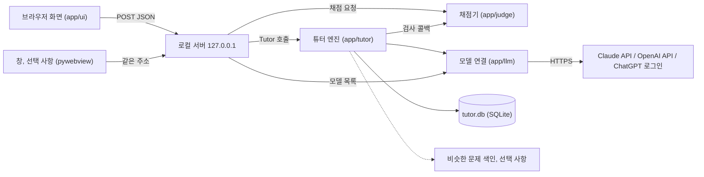

# AlgoBlock 구성 개요

AlgoBlock(알고블록)은 기기 안에서 도는 코딩테스트 학습 앱이다. 이 문서는 앱이 어떤 부분으로 나뉘어 있고 서로 어떻게 부르는지, 어느 부분이 모델을 부르지 않는지 설명한다.

## 한눈에 보기

화면에서 풀이 코드를 줄 범위로 나눈 조각을 '블록'이라 부른다.

## 연결 방식

- 화면은 모든 동작을 `POST` JSON으로 같은 서버에 보낸다.
- 로컬 서버는 표준 라이브러리 `ThreadingHTTPServer`로 만든다. `127.0.0.1`에만 묶이며 기본 포트는 8791이다. `ALGOBLOCK_UI_PORT`로 바꾼다.
- 서버가 정적 파일(HTML, CSS, JS, 아이콘, 글꼴)을 직접 준다.
- 서버는 요청마다 `Tutor`를 열고 닫는다. SQLite 연결은 만든 스레드에서만 쓸 수 있기 때문이다.
- 문제를 열면 서버가 뒤 스레드에서 `Tutor.prepare`를 돌려 뼈대, 풀이 가이드, 블록 계획을 미리 만든다. 모델 연결이 있을 때만 돌고, `ALGOBLOCK_UI_PREPARE=0`이면 돌지 않는다.
- 창 모드(`app/ui/window.py`)는 같은 프로세스에서 서버를 스레드로 띄우고, pywebview로 그 주소를 연다. macOS는 WKWebView, Windows는 WebView2를 쓴다. 포트가 이미 쓰이면 떠 있는 서버를 그대로 연다.
- 설치 파일은 `app/packaging/launcher.py`에서 시작한다. PyInstaller로 묶여 화면과 서버가 한 프로세스에서 돈다.

## 폴더와 책임

| 폴더 | 책임 |
|---|---|
| `app/ui/` | 화면(HTML·JS·CSS), 로컬 HTTP 서버, 창, 기본 문제와 케이스 도구 |
| `app/tutor/` | LangGraph 튜터 엔진(`Tutor`). 에이전트 13개(A1–A13, 표는 [튜터 엔진](tutor.md)에 있다), 에이전트마다 폴더 하나 |
| `app/tutor/store/` | SQLite 표 12개, 스키마 버전(현재 9) 처리, 저장소 |
| `app/tutor/knowledge/` | 온톨로지, 벡터 색인, 임베딩 |
| `app/tutor/llm/` | 엔진 쪽 모델 입구, 과정 표, 시험용 가짜 모델 |
| `app/tutor/eval/` | 측정과 평가 도구(비용 집계, 벤치) |
| `app/judge/` | 채점기(7개 언어 실행기, 인자 형 읽기) |
| `app/llm/` | 공급자 연결(Claude API 키, OpenAI API 키, ChatGPT 로그인), 사용량 기록 |
| `app/packaging/` | 설치 파일 만들기(PyInstaller, 맥·윈도 스크립트) |

## 모델을 부르지 않는 부분

모델 호출은 튜터 엔진의 노드에서만 일어난다. 서버는 그 밖에 키 연결의 모델 목록만 받는다. 아래 부분은 모델을 부르지 않는다.

- 채점기 전체(`app/judge`). 하위 프로세스 실행과 출력 비교만 한다.
- 학습 보고서, 다음 문제 고르기, 주제 상태 정하기. 저장된 기록에서 규칙으로 계산한다.
- 문제 글에서 케이스 찾기, 블록 모으기, 케이스 채우기.
- 엔진 안의 문맥 불러오기, 요청 검사, 나가는 글 검사, 저장.
- 질문 유형 고르기, 저장 힌트와 고정 문구 내기, 디버그 첫 증상 질문.
- 블록 채우기 (계획에 블록 코드가 있을 때).
- 기기 안 임베딩과 비슷한 문제 색인.

자세한 호출 수는 [모델 고르기·호출 수·비용](models-and-cost.md)에 있다.

## 더 읽을 문서

- [튜터 엔진](tutor.md)
- [채점기](judge.md)
- [온톨로지와 풀이 범위](ontology.md)
- [데이터 폴더](data.md)
- [모델 고르기·호출 수·비용](models-and-cost.md)
- [보안](security.md)
- 설치와 모델 연결: [연결 가이드](../guide/connect-ai.md)
