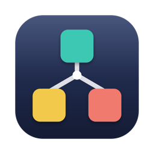
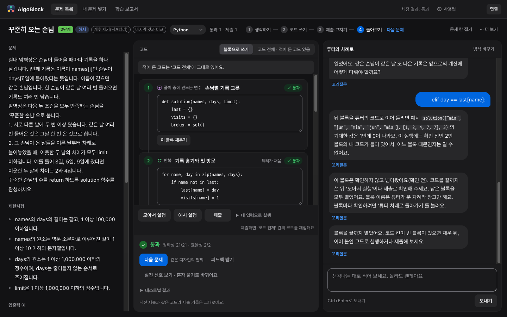
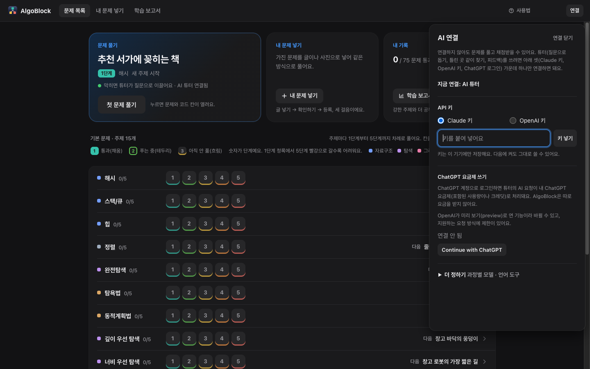
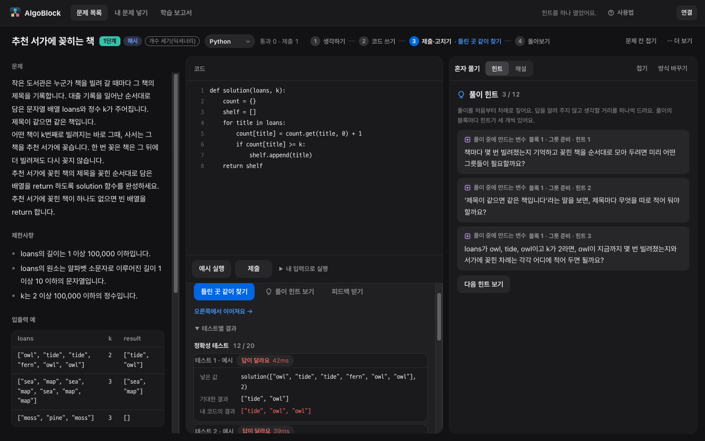
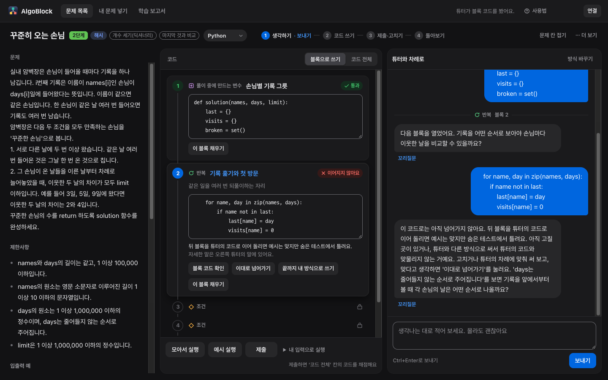
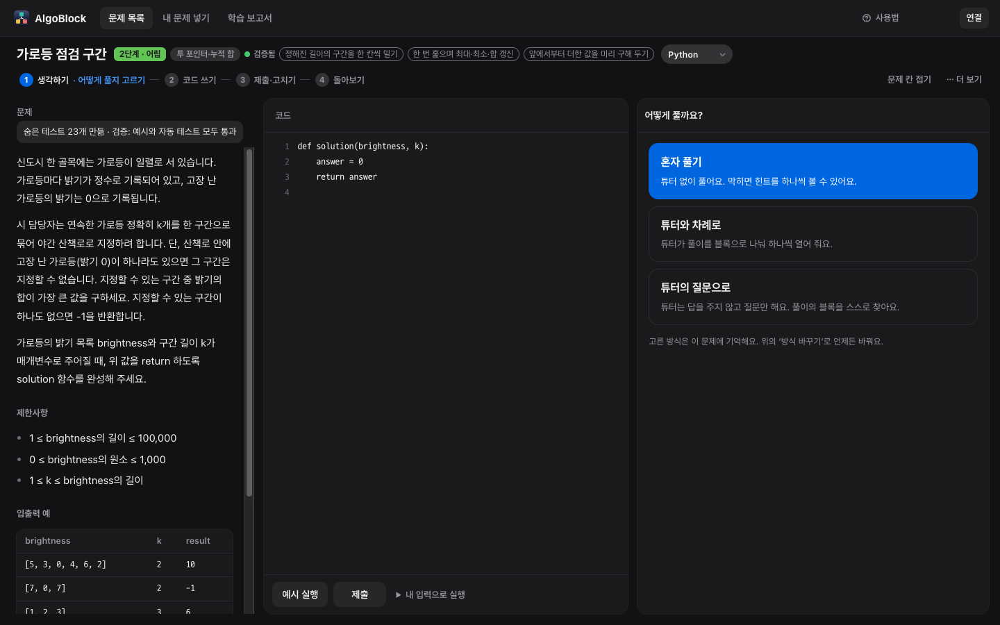
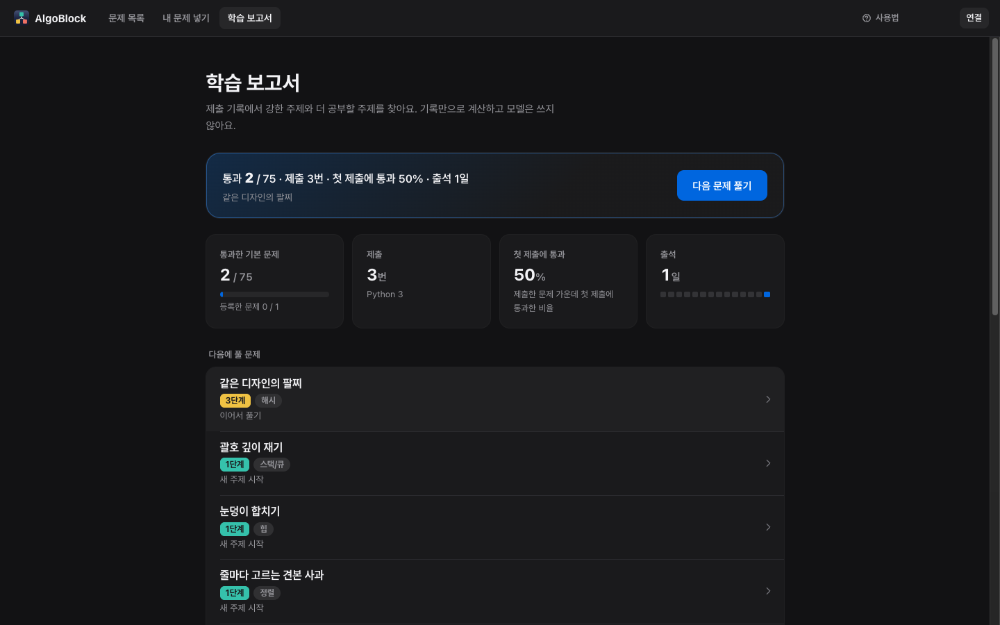

<p align="center"></p>

<div align="center">

$\bf{\large{\color{#6580DD} AlgoBlock }}$
===

알고블록

</div>

<p align="center"><b>풀이를 블록으로 나눠, 생각하는 순서를 익히는 코딩테스트 연습 앱입니다.</b> 내 컴퓨터에서 5개 언어로 문제를 풀고 바로 채점받을 수 있습니다. AI 튜터를 연결하면 풀이를 블록으로 나눠 하나씩 열어 주거나, 답 대신 질문으로 다음 블록을 스스로 찾게 이끕니다.</p>

<p align="center">
  <a href="https://github.com/algocean1204/AlgoBlock-coding-test-helper/actions/workflows/ci.yml"></a>
  <a href="LICENSE"></a>
</p>

<p align="center"><a href="https://github.com/algocean1204/AlgoBlock-coding-test-helper/releases/latest"></a></p>

<p align="center"><a href="https://github.com/algocean1204/AlgoBlock-coding-test-helper/releases/latest/download/AlgoBlock-macos-arm64.dmg"><b>macOS(Apple Silicon)용 내려받기</b></a> · <a href="https://github.com/algocean1204/AlgoBlock-coding-test-helper/releases/latest/download/AlgoBlock-windows-x64.exe"><b>Windows용 내려받기(베타)</b></a> · <a href="#소스로-실행하기">소스로 실행하기</a></p>

<p align="center"></p>

한 창에서 문제를 읽고, 블록 코드를 쓰고, 채점 결과를 보면서 튜터와 대화합니다. 기본 문제 75개(주제 15개 × 5단계)가 들어 있고, 가진 문제를 넣어 같은 방식으로 풀 수도 있습니다. 문제 풀기, 채점, 힌트, 기본 문제 해설, 학습 보고서는 키가 없어도 기기 안에서 돌아갑니다. 채점하려면 그 언어의 도구가 기기에 있어야 합니다. AI는 원할 때만 Claude·OpenAI 키를 넣거나 ChatGPT로 로그인(미리 보기)해 연결합니다. 연결하면 블록 이름을 먼저 보여 주고 채우게 하는 '튜터와 차례로', 답을 주지 않고 질문으로 이끄는 '튜터의 질문으로' 가운데 하나로 풀 수 있습니다.

## 기능

### 처음 쓰는 법

앱을 처음 켤 때 안내가 한 번 뜹니다. 연결하지 않아도 문제를 풀고 채점받을 수 있다는 내용부터 알려 주고 상단의 '사용법'을 누르면 다시 열립니다.

<p align="center"></p>

처음 안내의 세 번째 장입니다. 코드를 제출하면 결과 바로 아래에 다음에 할 일이 하나 나옵니다.

### 연결

오른쪽 위 '설정'의 'AI 연결'에서 Claude 키나 OpenAI 키를 넣거나 ChatGPT로 로그인합니다. 입력한 키는 이 기기에만 저장됩니다.

<p align="center"></p>

설정의 'AI 연결' 화면입니다. 키 입력 칸과 ChatGPT 로그인 단추가 있고, 왼쪽 분류에서 모델과 비용, 풀이 환경, 화면, 업데이트로 옮겨 갑니다.

### 풀고 채점받기

기본 문제 75개(주제 15개 × 5단계)를 Python, Java, JavaScript, C++, Rust로 풉니다. 예시를 실행해 보고 제출하면 정확성 테스트와 효율성 테스트로 채점합니다. 숨은 테스트는 통과 여부만 보입니다. 이 기능은 모델을 부르지 않아서 키가 없어도 기기 안에서 돌아갑니다.

### 혼자 풀기

튜터 없이 혼자 풀다가 막히면 풀이 힌트를 하나씩 열 수 있습니다. 힌트는 블록마다 세 개씩 있고, 처음부터 차례로 풀이를 짚어 줍니다.

<p align="center"></p>

혼자 풀기 화면입니다. 오른쪽 '힌트'에 본 힌트가 쌓이고 '3 / 12'처럼 몇 개를 봤는지 보입니다.

### 튜터와 블록으로 풀기

AI를 연결하면 튜터가 풀이 코드를 줄 범위로 나누어 블록을 하나씩 열어 줍니다. '튜터와 차례로'는 블록 이름을 먼저 보여 주고 그 블록을 채우도록 이끄는 방식이고 '튜터의 질문으로'는 답을 주지 않고 질문만 해 블록을 스스로 찾게 하는 방식입니다. 블록에 적은 코드는 앞뒤 블록과 이어 실행해서 확인합니다. 넘어간 블록에서 '끝까지 내 방식으로 쓰기'를 누르면 남은 블록이 모두 열립니다. 코드를 다 쓴 뒤에는 '모아서 실행'으로 한 번에 확인합니다.

<p align="center"></p>

블록 2를 튜터 코드와 이어 실행하자 '이어지지 않아요'가 뜬 모습입니다. 튜터는 코드를 고치거나 '이대로 넘어가기'를 고르라고 안내해 줍니다.

<p align="center"></p>

'끝까지 내 방식으로 쓰기'를 고른 화면입니다. 남은 블록이 모두 열리고, 튜터가 '모아서 실행'으로 확인하라고 안내합니다.

### 틀린 곳 같이 찾기

제출한 코드가 통과하지 못하면 튜터가 어느 입력에서 무엇이 달랐는지 보여 주고 어느 줄부터 코드를 따라가 볼지 묻습니다. 고친 코드를 보내면 다시 채점해 줍니다.

<p align="center"></p>

튜터가 입력 하나를 어느 줄부터 손으로 따라갈지 묻습니다.

### 내 문제 넣기

문제 글을 붙여 넣거나 md·txt·PDF·이미지로 올리고 입출력 예 표에서 케이스를 채웁니다. AI가 연결돼 있으면 정답 풀이를 만들어 실행 결과를 대조하고 검증 표시로 보여 줍니다.

<p align="center"></p>

등록한 문제 화면입니다. 숨은 테스트 23개가 만들어졌고 '예시와 자동 테스트 모두 통과'라는 검증 결과가 보입니다.

### 학습 보고서

제출 기록에서 주제별 진행 상황, 첫 제출에 통과한 비율, 출석, 다음에 풀 문제를 계산합니다. 도움 없이 푼 기본 문제를 기준으로 준비도 단계와 다음 단계까지 남은 주제를 알려 주고 여러 주제에서 되풀이된 실패도 모아 보여 줍니다. 이 기능은 모델을 부르지 않습니다.

<p align="center"></p>

통과 수, 제출 수, 첫 제출 통과 비율, 출석, 다음에 풀 문제를 한 화면에서 봅니다.

## 지원하는 언어와 모델

| | |
| --- | --- |
| 채점 언어 | Python, Java, JavaScript, C++, Rust로 채점합니다. 기기에 해당 언어의 도구가 있어야 합니다 |
| AI 연결 | Claude API 키, OpenAI API 키, ChatGPT 로그인 가운데 하나를 연결합니다(선택) |
| 모델 | 과정마다 급을 고릅니다. Claude는 Haiku·Sonnet·Opus, OpenAI는 Luna·Terra·Sol 시리즈의 최신 버전을 씁니다 |

자세한 내용은 [AI 연결](Docs/guide/connect-ai.md)에 있습니다.

## AI 비용

AI를 연결하지 않아도 문제 풀기, 채점, 힌트, 학습 보고서를 모두 쓸 수 있습니다. API 키로 연결하면 쓴 만큼 요금이 나갑니다.

- 1~2단계는 AI 없이 직접 풀어 보기를 권합니다. 기본 문제의 힌트와 해설은 AI 없이도 볼 수 있습니다.
- 3단계부터는 막히는 곳에서 튜터를 써 보기를 권합니다.

깊은 1문제 학습을 기준으로 잰 비용입니다. 4단계 기본 문제 하나를 '튜터의 질문으로' 방식으로 약 20턴 주고받고, 제출한 뒤 피드백까지 받았습니다.

| 경우 | 비용 |
| --- | --- |
| 기본 문제 깊은 1문제 학습 | 약 0.01달러 |
| 내 문제 넣기(글로 넣은 2단계 문제 하나: 단계 분석, 숨은 테스트, 풀이 가이드, 블록, 힌트를 만들고 짧게 풀어 피드백까지) | 약 0.014달러 |

2026년 11월 16일에 Claude API 키와 기본 모델 설정으로 쟀습니다. 대화·판정·피드백은 Haiku 5.5이고, 내 문제 준비도 Haiku 5.5(추론 high)로 합니다. 준비한 풀이가 예시를 통과하지 못하거나 대조 풀이와 맞지 않으면 Sonnet, 그다음 Opus로 다시 풀고, 다시 풀 때는 비용이 더 듭니다. 문제 준비 비용은 문제를 넣을 때 듭니다. 다른 언어로 바꿔 풀면 그 언어의 풀이를 새로 만들어 비용이 더 들 수 있습니다. 실제 비용은 대화 길이, 모델 설정, 공급자 요금에 따라 달라집니다. ChatGPT 로그인은 미리 보기 단계라 이번에 재지 않았습니다. 이 연결은 ChatGPT 요금제의 사용 한도를 따릅니다.

## 설치

### 내려받기

아래 링크에서는 늘 [최신 릴리스](https://github.com/algocean1204/AlgoBlock-coding-test-helper/releases/latest)의 파일을 받습니다. 버전마다 바뀐 내역은 [릴리스 목록](https://github.com/algocean1204/AlgoBlock-coding-test-helper/releases)에 있습니다. 버전은 `0.x.y`이고, 큰 업데이트에는 둘째 숫자가, 작은 고침에는 셋째 숫자가 오릅니다.

| 운영체제 | 파일 |
| --- | --- |
| macOS (Apple Silicon) | [AlgoBlock-macos-arm64.dmg](https://github.com/algocean1204/AlgoBlock-coding-test-helper/releases/latest/download/AlgoBlock-macos-arm64.dmg) |
| Windows (x64, 베타) | [AlgoBlock-windows-x64.exe](https://github.com/algocean1204/AlgoBlock-coding-test-helper/releases/latest/download/AlgoBlock-windows-x64.exe) |

macOS는 내려받은 `.dmg`를 열어 앱을 `Applications`로 옮깁니다. Windows는 내려받은 `.exe`를 실행합니다. 채점 언어(Python, JDK, Node.js, g++/clang++, rustc)의 도구는 두 설치 파일 모두에 들어 있지 않습니다. 앱 안에 든 파이썬은 앱을 돌리는 데만 쓰고, 채점은 기기에 설치한 도구로 합니다. 자세한 내용은 [설치](Docs/guide/install.md)에 있습니다.

#### macOS에서 처음 열 때

설치 파일에 Apple 서명과 공증이 없어서 처음 열면 "'AlgoBlock.app'을(를) 열지 않음" 창이 뜹니다. 앱이 망가졌다는 뜻은 아닙니다. 아래처럼 한 번만 허용하면 됩니다.

1. 경고 창에서 **'완료'**를 누릅니다. '휴지통으로 이동'은 누르지 않습니다.
2. 시스템 설정 → **개인정보 보호 및 보안**을 열고 아래로 내립니다. AlgoBlock이 차단되었다는 안내 옆의 **'그래도 열기'**를 누르고 암호를 넣습니다. 이 단추는 앱이 차단된 뒤 한 시간쯤만 보입니다. 보이지 않으면 앱을 한 번 더 열어 막힌 뒤 다시 찾습니다.
3. 앱을 다시 열면 뜨는 창에서 **'열기'**를 누릅니다. 한 번 허용하면 다음부터는 바로 열립니다.

터미널을 쓸 수 있으면 앱을 `Applications`로 옮긴 뒤 아래 한 줄로도 해결됩니다. 내려받은 파일에 붙는 격리 속성만 지워 이 앱의 검사를 건너뛰는 명령이므로 이 저장소의 릴리스에서 받은 파일에만 씁니다.

```bash
xattr -dr com.apple.quarantine /Applications/AlgoBlock.app
```

앱 안의 업데이트 기능으로 받은 새 버전에는 이 경고가 다시 뜨지 않습니다. 브라우저로 새 dmg를 받아 직접 바꿔 넣으면 다시 뜹니다.

새 버전이 나오면 앱 상단 막대에 알림이 뜹니다. 내려받기와 '다시 시작해 업데이트' 두 단추로 업데이트합니다. Windows 앱도 같은 두 단추로 업데이트합니다.

#### Windows에서 처음 열 때

실행 파일에 코드 서명이 없어서 처음 열면 Microsoft Defender SmartScreen의 'Windows의 PC 보호' 창이 뜰 수 있습니다. 앱이 망가졌다는 뜻은 아닙니다. 창에서 **'추가 정보'**를 누른 뒤 **'실행'**을 누릅니다. 이 저장소의 릴리스에서 받은 파일에만 이렇게 합니다.

### 코드 서명 정책

- 지금 릴리스의 macOS 앱과 Windows 실행 파일에는 코드 서명이 없습니다. 그래서 처음 열 때 위의 경고가 뜹니다.
- Windows 실행 파일의 코드 서명은 [SignPath Foundation](https://signpath.org)의 무료 오픈소스 프로그램에 신청해 심사를 기다리고 있습니다.
- 릴리스 파일은 이 저장소의 코드로만 만듭니다. Windows 실행 파일은 이 저장소의 CI(GitHub Actions)가, macOS 앱은 `app/packaging/build_mac.sh`가 만듭니다. 파일마다 SHA-256을 릴리스의 `SHA256SUMS`에 적습니다.
- 역할: 커밋, 바깥 기여의 검토, 릴리스 승인을 모두 유지자 [@algocean1204](https://github.com/algocean1204)가 맡습니다.

### 소스로 실행하기

소스로 실행하려면 Python 3.12와 [uv](https://docs.astral.sh/uv/)가 필요합니다.

```bash
git clone -b main https://github.com/algocean1204/AlgoBlock-coding-test-helper.git
cd AlgoBlock-coding-test-helper/app
uv run --no-project --python 3.12 --with langgraph --with pypdf python ui/server.py
```

브라우저에서 http://127.0.0.1:8791 을 엽니다. 포트는 `ALGOBLOCK_UI_PORT`로, 자료 폴더는 `ALGOBLOCK_UI_DATA`로 바꿀 수 있습니다. 자료 폴더의 기본값은 `app/ui/data`이고(Git에 올라가지 않습니다) 이곳에 풀이 기록·등록한 문제·넣은 키가 저장됩니다. 키는 화면의 '설정'의 'AI 연결'에서 넣거나 저장소 루트에서 `.env.example`을 `.env`로 복사해 채우는데 키가 없어도 문제 풀기, 채점, 힌트, 해설, 학습 보고서 기능은 모두 쓸 수 있습니다.

## 개인정보

AlgoBlock에는 계정이 없고, 사용 기록을 모으는 서버도 없습니다. 문제, 코드, 대화, 학습 기록은 이 기기의 데이터 폴더에만 저장합니다. 기기 밖으로 나가는 요청은 AI 연결과 업데이트에 쓰는 것뿐이고, 나가는 곳과 내용의 전체 목록은 [데이터 폴더](Docs/architecture/data.md#기기-밖으로-나가는-것)에 있습니다.

- AI 연결: 튜터를 쓸 때 사용자가 연결한 공급자(Anthropic 또는 OpenAI)에 문제 글, 내 말, 내 코드, 채점 결과를 보냅니다. 문제를 넣을 때 올린 그림도 보냅니다. 키를 확인하거나 모델 목록을 받을 때는 목록 조회만 보내고 문제와 코드는 싣지 않습니다. ChatGPT 로그인은 OpenAI의 로그인 서버와 로그인 요청과 토큰만 주고받습니다. AI를 연결하지 않으면 이 요청은 하나도 나가지 않습니다.
- 업데이트: GitHub에 새 릴리스가 있는지 묻고, 내려받기를 누르면 이 저장소의 릴리스 파일을 받습니다. 키, 문제, 기록은 싣지 않습니다. 설정 → 업데이트에서 자동 확인을 끌 수 있습니다.

## 문서

- 쓰는 사람: [설치](Docs/guide/install.md) · [AI 연결](Docs/guide/connect-ai.md) · [풀기](Docs/guide/solve.md) · [내 문제 넣기](Docs/guide/add-problem.md) · [베타로 써 보기](Docs/guide/beta.md)
- 고치는 사람: [문서 지도](Docs/README.md) · [구조](Docs/architecture/overview.md) · [기여 안내](.github/CONTRIBUTING.md)
- 보안 문제 알리기: [SECURITY.md](.github/SECURITY.md)
- 질문은 Discussions에, 버그와 제안은 이슈 양식으로 올립니다.

## 알려진 한계

- 채점할 코드(직접 적은 코드와 튜터가 만든 코드)를 격리하지 않고 사용자 권한으로 실행합니다. 자세한 내용은 [보안 구조](Docs/architecture/security.md)에 있습니다.
- 설치 파일에 서명이 없습니다.
- Windows 버전은 베타입니다. 실제 Windows PC에서 넓게 확인하지 못했습니다. 문제가 있으면 이슈로 알려 주세요.
- ChatGPT 연결은 OpenAI의 Sign in with ChatGPT(오픈소스 앱의 요금제 사용, 미리 보기 단계)를 쓰므로 ChatGPT 요금제의 사용 한도를 따릅니다. 실제 계정으로 끝까지 제대로 도는지는 아직 확인하지 않았습니다.
- 튜터가 사용자 코드의 이름과 풀이 코드의 이름을 짝짓지 못하면 그 블록을 '확인 전'으로 둡니다. 이때 이름을 맞추거나 '이대로 넘어가기'를 누르라고 안내합니다.
- '튜터와 차례로'에서는 블록을 확인할 때 튜터 코드와 이어 실행합니다. 튜터와 다른 구조(다른 자료구조, 다른 입력 읽기, 한 블록에 더 많은 일, 직접 닫은 괄호)로 쓴 올바른 블록이라도 그 자리에서는 '이어지지 않아요'나 '확인 전'이 될 수 있습니다. 틀렸다는 뜻이 아니므로 '이대로 넘어가기'로 다음 블록을 열 수 있고 코드를 끝까지 쓴 뒤에는 실행이나 제출로 확인합니다. 이때 '끝까지 내 방식으로 쓰기'로 남은 블록을 열고 다 쓴 뒤 확인해도 됩니다.
- 이름을 맞춰 이어 돌릴 때 JavaScript의 정규식 글자와 중첩된 템플릿 문자열 안의 낱말까지 바뀌어 실행 결과가 달라질 수 있습니다. 이럴 때는 튜터가 쓰는 이름으로 맞춰 적으면 됩니다.
- 기본 문제의 Python 밖 네 언어 풀이 300개 가운데 63개(19문제)는 풀이 가이드와 블록을 미리 싣지 않았습니다. 그 언어 풀이를 Python 블록과 같은 차례·같은 일로 나눌 수 없어서입니다. Python 블록의 단계가 그 언어 풀이에는 없거나 다른 블록과 합쳐져 있고(방향 표 없이 반복 안에서 바로 따지거나, 비교 기준을 정렬 안에 바로 쓰거나, 정렬 대신 최댓값과 합을 쓰는 경우 등), 도움 함수의 자리가 다르거나 같은 일을 다른 방법으로 짠 경우도 있습니다. 그 언어로 처음 튜터와 시작하면 그때 새로 만드느라 기다리게 됩니다.
- 튜터의 말은 모델이 만듭니다. 규칙 검사를 거치지만 답을 먼저 말하는 것 같은 원칙 위반이 남을 수 있습니다.
- 표준 입출력 문제의 출력은 줄 끝 공백과 끝의 빈 줄만 빼고 글자 그대로 비교하고 등록할 때 '실수 답'을 켠 문제만 기대 출력에 소수로 적힌 값의 0.000001 차이까지 같은 값으로 봅니다. '답이 여럿일 수 있음'을 켠 문제에서는 예시와 다른 답이 맞는지 가리지 못합니다. 그래서 제출은 통과로 치지 않고 블록은 확인 전으로 둡니다. 숨은 테스트도 만들지 않습니다.
- 튜터 풀이가 예시를 통과하지 못했거나 아직 없으면 튜터 코드가 남은 블록은 그 코드와 이어 돌려 확인하지 않습니다. 대신 '확인 전'으로 둔 채 다음 블록으로 넘어가고 코드를 끝까지 쓴 뒤 실행이나 제출로 확인합니다.
- 실행 도구나 케이스가 없거나 채점기가 인자 형을 다루지 못하면 AI가 코드를 읽고 블록을 판단합니다. 이때 통과 판정은 '확인 전'으로 두고 거절 판정은 틀린 수에 넣지 않은 채 실행하지 못했다고 알립니다. 공개 예시만 있는 문제를 통과하면 '예시 통과'로 보이고 '공개 예시로만 확인했어요'라고 알려 줍니다.
- 예제 구역은 다음 제목이나 빈 줄이 두 줄 이어지는 곳에서 끊습니다. 기대 출력 안에 빈 줄이 있으면 알리기만 하고, 빈 줄 없이 붙은 설명 글은 구분하지 못합니다.
- 블록 1의 진입 함수 선언부를 시작 코드와 다른 형태(화살표 함수 등)로 적으면 이어 돌린 실행이 실패할 수 있습니다.
- Rust·JavaScript에서는 이어 붙인 프로그램에 시작 코드의 가져오기 줄을 넣지 않습니다. 그래서 시작 코드의 가져오기에 의존하는 올바른 블록도 '이어지지 않아요'로 보일 수 있습니다.

## 라이선스

라이선스는 [MIT](LICENSE)입니다. 함께 쓰거나 묶어 배포하는 항목의 라이선스는 [Docs/THIRD_PARTY_NOTICES.md](Docs/THIRD_PARTY_NOTICES.md)에 있습니다.
