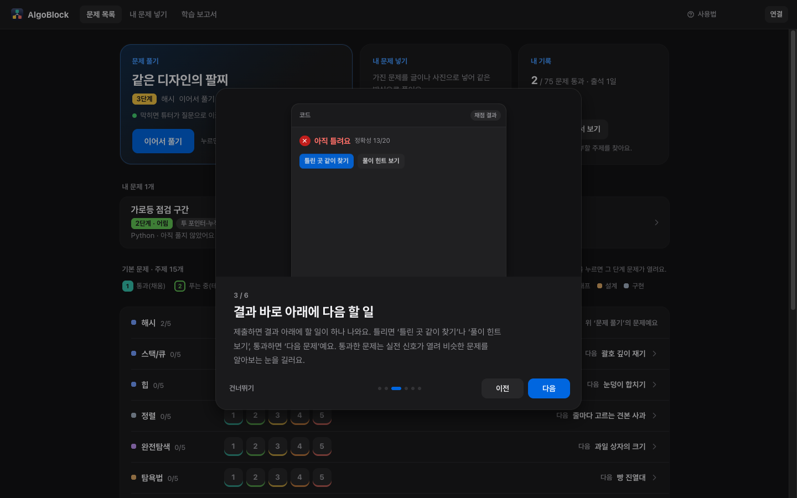
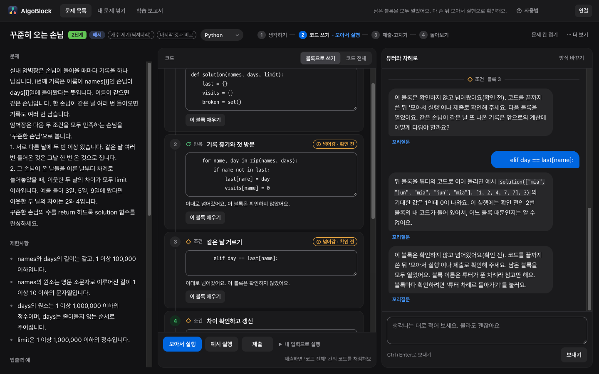
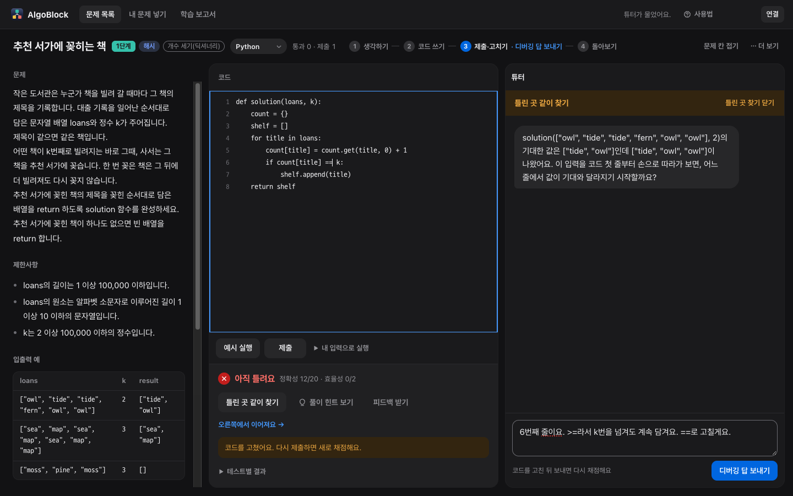

<p align="center"></p>

<div align="center">

$\bf{\large{\color{#6580DD} AlgoBlock }}$
===

알고블록

</div>

<p align="center"><b>기기 안에서 도는 코딩테스트 학습 앱.</b> 7개 언어로 풀고 채점받고, 원하면 AI 튜터가 풀이를 블록으로 나눠 질문으로 이끈다.</p>

<p align="center">
  <a href="https://github.com/algocean1204/AlgoBlock-coding-test-helper/actions/workflows/ci.yml"></a>
  <a href="LICENSE"></a>
</p>

<p align="center"><a href="https://github.com/algocean1204/AlgoBlock-coding-test-helper/releases/latest/download/AlgoBlock-macos-arm64.dmg"><b>macOS(Apple Silicon)용 내려받기</b></a> · <a href="#소스로-실행하기">소스로 실행하기</a></p>

<p align="center"></p>

문제를 읽고, 블록 코드를 쓰고, 채점 결과를 보고, 튜터와 대화하는 것이 한 창에 있다.

## 기능

### 처음 쓰는 법

처음 켤 때 안내가 한 번 뜬다. 연결하지 않아도 풀고 채점받을 수 있다는 것부터 말한다. 상단의 '사용법'으로 다시 연다.

<p align="center"></p>

처음 안내의 세 번째 장이다. 제출하면 결과 바로 아래에 할 일이 하나 나온다.

### 연결

오른쪽 위 '연결'에서 Claude 키나 OpenAI 키를 넣거나 ChatGPT로 로그인한다. 키는 이 기기에만 저장한다.

<p align="center"></p>

연결 창이다. 키 입력 칸과 ChatGPT 로그인 단추, 과정별 모델과 업데이트 설정으로 가는 '더 정하기'가 있다.

### 풀고 채점받기

기본 문제 75개(주제 15개 × 5단계)를 Python, Java, JavaScript, C++, Go, Kotlin, Rust로 푼다. 예시를 실행하고, 제출하면 정확성 테스트와 효율성 테스트로 채점한다. 숨은 테스트는 통과 여부만 보인다. 이 기능은 모델을 부르지 않으므로 키 없이 된다.

### 혼자 풀기

튜터 없이 푼다. 막히면 풀이 힌트를 하나씩 연다. 힌트는 풀이의 블록마다 세 개씩 있고, 풀이를 처음부터 차례로 짚는다.

<p align="center"></p>

혼자 풀기 화면이다. 오른쪽 '힌트'에 본 힌트가 쌓이고 '3 / 12'처럼 몇 개를 봤는지 보인다.

### 튜터와 블록으로 풀기

AI를 연결하면 튜터가 풀이 코드를 줄 범위로 나눈 블록을 하나씩 연다. '튜터와 차례로'는 블록 이름을 먼저 보여 주고 그 블록을 채우도록 이끌고, '튜터의 질문으로'는 답을 주지 않고 질문만 해 블록을 스스로 찾게 한다. 블록에 적은 코드는 앞뒤 블록과 이어 실행해서 확인한다. 넘어간 블록에서 '끝까지 내 방식으로 쓰기'를 누르면 남은 블록을 모두 열고, 다 쓴 뒤 '모아서 실행'으로 한 번에 확인한다.

<p align="center"></p>

블록 2는 튜터의 코드와 이어 돌린 결과 '이어지지 않아요'가 떴다. 튜터는 고치거나 '이대로 넘어가기'를 고르라고 안내한다.

<p align="center"></p>

'끝까지 내 방식으로 쓰기'를 고른 화면이다. 남은 블록이 모두 열리고, 튜터가 '모아서 실행'으로 확인하라고 안내한다.

### 틀린 곳 같이 찾기

제출이 통과하지 못하면 튜터가 어느 입력에서 무엇이 달랐는지 보여 주고, 코드를 따라가 볼 줄을 묻는다. 고친 코드를 보내면 다시 채점한다.

<p align="center"></p>

튜터가 입력 하나를 어느 줄부터 손으로 따라갈지 묻는다.

### 내 문제 넣기

문제 글을 붙여 넣거나 md·txt·PDF·이미지로 올리고, 입출력 예 표에서 케이스를 채운다. AI가 연결돼 있으면 정답 풀이를 만들어 실행으로 대조하고, 그 결과를 검증 표시로 보여 준다.

<p align="center"></p>

등록한 문제 화면이다. 숨은 테스트 23개가 만들어졌고 '예시와 자동 테스트 모두 통과'라는 검증 결과가 보인다.

### 학습 보고서

제출 기록에서 주제별 진행, 첫 제출에 통과한 비율, 출석, 다음에 풀 문제를 계산한다. 모델을 부르지 않는다.

<p align="center"></p>

통과 수, 제출 수, 첫 제출 통과 비율, 출석, 다음에 풀 문제를 한 화면에서 본다.

## 지원하는 언어와 모델

| | |
| --- | --- |
| 채점 언어 | Python, Java, JavaScript, C++, Go, Kotlin, Rust. 기기에 그 언어의 도구가 있어야 한다 |
| AI 연결 | Claude API 키, OpenAI API 키, ChatGPT 로그인 가운데 하나(선택) |
| 모델 | 과정마다 급을 고른다. Claude는 Haiku·Sonnet·Opus, OpenAI는 Luna·Terra·Sol 시리즈의 최신 버전을 쓴다 |

자세한 것은 [AI 연결](Docs/guide/connect-ai.md)에 있다.

## 설치

### 내려받기

| 운영체제 | 파일 |
| --- | --- |
| macOS (Apple Silicon) | [AlgoBlock-macos-arm64.dmg](https://github.com/algocean1204/AlgoBlock-coding-test-helper/releases/latest/download/AlgoBlock-macos-arm64.dmg) |

설치 파일에는 서명이 없다. `.dmg`를 열어 앱을 `Applications`로 옮긴다. 처음 열 때 "열 수 없다"는 경고가 뜬다. 경고를 닫고 시스템 설정 → 개인정보 보호 및 보안 → '그래도 열기'를 누른다(macOS 14까지는 앱을 우클릭 → '열기'로도 된다). 한 번 열면 다음부터는 그냥 열린다. 채점 언어의 도구는 설치 파일에 들어 있지 않다. 자세한 것은 [설치](Docs/guide/install.md)에 있다.

새 버전이 나오면 앱 위쪽 막대에 알려 주고, 내려받기와 '다시 시작해 업데이트' 두 단추로 바꾼다(macOS, Windows).

### 소스로 실행하기

Python 3.12와 [uv](https://docs.astral.sh/uv/)가 필요하다.

```bash
git clone https://github.com/algocean1204/AlgoBlock-coding-test-helper.git
cd AlgoBlock-coding-test-helper/app
uv run --no-project --python 3.12 --with langgraph --with pypdf python ui/server.py
```

브라우저에서 http://127.0.0.1:8791 을 연다. 포트는 `ALGOBLOCK_UI_PORT`로, 자료 폴더는 `ALGOBLOCK_UI_DATA`로 바꾼다. 자료 폴더의 기본값은 `app/ui/data`이고(Git에 올라가지 않는다), 풀이 기록·등록한 문제·넣은 키가 거기에 쌓인다. 키는 화면의 '연결'에서 넣거나, 저장소 루트에서 `.env.example`을 `.env`로 복사해 채운다. 키가 없어도 문제 풀기, 채점, 힌트, 해설, 학습 보고서는 된다.

## 문서

- 쓰는 사람: [설치](Docs/guide/install.md) · [AI 연결](Docs/guide/connect-ai.md) · [풀기](Docs/guide/solve.md) · [내 문제 넣기](Docs/guide/add-problem.md)
- 고치는 사람: [문서 지도](Docs/README.md) · [구조](Docs/architecture/overview.md) · [기여 안내](.github/CONTRIBUTING.md)
- 보안 문제 알리기: [SECURITY.md](.github/SECURITY.md)
- 질문은 Discussions, 버그와 제안은 이슈 양식으로 올린다.

## 알려진 한계

- 채점하는 코드(직접 적은 코드와 튜터가 만든 코드)를 격리하지 않는다. 사용자 권한으로 돈다. [보안 구조](Docs/architecture/security.md)
- 설치 파일에 서명이 없다.
- 실제 Windows PC에서 돌려 보지 않았다. 그래서 내려받기 표에 Windows가 없다.
- ChatGPT 연결은 OpenAI의 Sign in with ChatGPT(오픈소스 앱의 요금제 사용, 미리 보기 단계)를 쓴다. ChatGPT 요금제의 사용 한도를 따르고, 실제 계정으로 끝까지 되는지는 아직 확인하지 않았다.
- 튜터가 사용자 코드의 이름과 풀이 코드의 이름을 짝짓지 못하면 그 블록을 '확인 전'으로 두고, 이름을 맞추거나 '이대로 넘어가기'를 누르라고 알린다.
- '튜터와 차례로'의 블록 확인은 튜터의 코드와 이어 돌려 본다. 튜터와 다른 구조(다른 자료구조, 다른 입력 읽기, 한 블록에 더 많은 일, 직접 닫은 괄호)로 쓴 맞는 블록은 그 자리에서 '이어지지 않아요'나 '확인 전'이 될 수 있다. 틀렸다는 뜻이 아니고 '이대로 넘어가기'로 다음 블록을 열 수 있다. 코드를 끝까지 쓴 뒤 실행이나 제출로 확인한다. 그때는 '끝까지 내 방식으로 쓰기'로 남은 블록을 열고 다 쓴 뒤 확인할 수 있다.
- 이름을 맞춰 이어 돌릴 때, JavaScript의 정규식 글자와 중첩된 템플릿 문자열 안의 낱말까지 바뀌어 실행 결과가 달라질 수 있다. 그때는 튜터의 이름으로 맞춰 적으면 된다.
- 기본 문제를 Python이 아닌 언어로 처음 튜터와 시작하면 풀이 가이드와 블록을 그때 만드느라 기다린다.
- 튜터의 말은 모델이 짓는다. 규칙 검사를 거치지만 답을 먼저 말하는 것 같은 원칙 위반이 남을 수 있다.
- 표준 입출력 문제의 출력은 줄 끝 공백과 끝의 빈 줄만 빼고 글자 그대로 견준다. 등록할 때 '실수 답'을 켠 문제만 기대 출력에 소수로 적힌 값을 0.000001 차이까지 같게 본다. '답이 여럿일 수 있음'을 켠 문제는 예시와 다른 답이 맞는지 가리지 못하고(제출은 통과로 치지 않고, 블록은 확인 전), 숨은 테스트를 만들지 않는다.
- 튜터의 풀이가 예시를 통과하지 못했거나 아직 없으면, 튜터 코드가 남은 블록은 그 코드와 이어 돌려 확인하지 않고 '확인 전'으로 두고 다음 블록으로 넘어간다. 코드를 끝까지 쓴 뒤 실행이나 제출로 확인한다.
- 실행 도구나 케이스가 없거나 채점기가 인자 형을 다루지 못하면 블록 확인은 AI가 코드를 읽고 판단하며, 그 통과는 '확인 전'으로, 읽고 낸 거절은 틀린 수에 넣지 않고 실행하지 못했다고 알린다. 공개 예시만 있는 문제의 통과는 '예시 통과'로 보이고 '공개 예시로만 확인했어요'라고 알린다.
- 예제 구역은 다음 머리나 빈 줄이 두 줄 이어지는 곳에서 끊는다. 기대 출력 안에 빈 줄이 있으면 알리기만 하고, 빈 줄 없이 붙은 설명 글은 알아보지 못한다.
- 블록 1의 진입 함수 머리를 시작 코드와 다른 꼴(화살표 함수 등)로 적으면 이어 돌린 실행이 실패할 수 있다.
- Go·Rust·JavaScript는 시작 코드의 가져오기 줄을 이어 붙인 프로그램에 더하지 않는다. 시작 코드의 가져오기에 기댄 맞는 블록이 '이어지지 않아요'로 보일 수 있다.

## 라이선스

[MIT](LICENSE). 함께 쓰거나 묶어 배포하는 것의 라이선스는 [Docs/THIRD_PARTY_NOTICES.md](Docs/THIRD_PARTY_NOTICES.md)에 있다.
