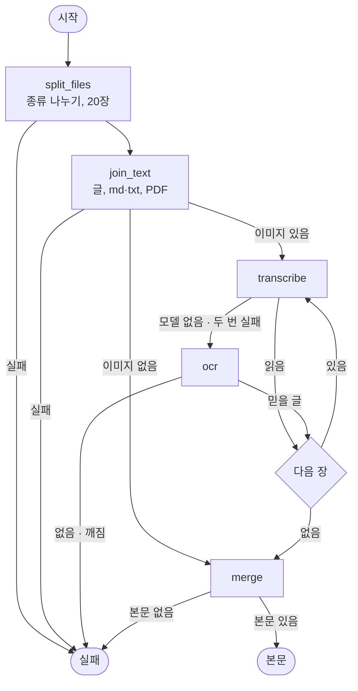

# ingest — 문항 읽기

폴더 `tutor/ingest/`: `files.py`(파일 나누기), `text.py`(글 잇기, PDF), `ocr.py`(tesseract), `transcribe.py`(모델로 이미지 옮겨 적기), `check.py`(읽기 검증), `nodes.py`·`graph.py`(그래프).

## 하는 일

문항 등록 때 입력 글, md·txt, PDF, 이미지에서 본문을 만든다. 메인 튜터 그래프 밖이다. 저장하지 않는다. 문제를 지어내지 않는다.

| 하는 일 | 모델 | 노드 | 내용 |
| --- | --- | --- | --- |
| 파일 나누기 | 없음 | `split_files` | 확장자로 글 파일(md, txt, pdf)과 이미지(png, jpg, jpeg, webp, gif, bmp)를 나눈다. 그 밖의 파일과 이미지 21장 이상은 거절한다 |
| 글 잇기 | 없음 | `join_text` | 입력 글 → md·txt(UTF-8, 아니면 CP949)·PDF를 올린 순서로 빈 줄 하나를 두고 잇는다 |
| PDF 글 뽑기 | 없음 | `join_text` | `pypdf`. 글이 없거나 깨진 파일이면 실패한다. 제어 문자는 공백으로 바꾼다 |
| 이미지 옮겨 적기 | 씀 | `transcribe` · task `ingest.transcribe` | AI가 연결돼 있으면 이미지는 모델로 읽는다. 한 장씩, 그 장 이미지 하나만 넘긴다. 한 장을 두 번까지 읽는다 |
| tesseract | 없음 | `ocr` | 모델이 연결돼 있지 않거나(`LlmNotConfigured`) 그 장을 두 번 못 읽었을 때만. `kor+eng`, `--psm 4`, 10초. 공백 빼고 20자 이상이고 깨진 글자가 10% 이하면 쓴다 |
| 잇기 | 없음 | `merge` | 이미지 장끼리 앞 장 끝과 겹친 줄을 뒤 장에서 빼고 잇는다. 본문이 비면 실패한다 |

`extract_with_note`는 본문과 함께 tesseract로 읽은 장이 있었는지를 준다: `False`(쓰지 않음), `True`(AI 연결 없음), `"ai_failed"`(AI로 두 번 못 읽은 장이 있음).

## 그래프

입구는 `extract(text, files) -> 본문`이다. `files`는 (이름, 바이트) 목록이다. 읽은 상태 전체가 필요하면 `read_pages`를 쓴다.

## 입력 · 출력

| | 내용 |
| --- | --- |
| 입력 | 입력 글, 파일(이미지 20장 이하, md·txt, PDF). PDF를 1개로 묶는 제한은 화면 서버가 건다 |
| 출력 | 마크다운 본문 하나 |

## 모델 입력

| 넣는 것 | 빼는 것 |
| --- | --- |
| 그 장 이미지, 장 번호, "보이는 글만 옮겨 적어라. 문제를 지어내지 마라", 제목(`## 제약`, `## 입력`, `## 출력`)과 표를 옮기는 규칙 | 다른 장 이미지 |

모델 답이 비었거나 "보이지 않습니다" 같은 설명 한 줄이면 못 읽은 것으로 보고 다시 읽는다.

## 실패

| 조건 | 결과 |
| --- | --- |
| 모델이 없음, 또는 호출 실패·시간 초과·글이 빔이 두 번 | 그 장은 tesseract로 |
| PDF에 글이 없음, 깨진 PDF, 받지 않는 파일, 이미지 21장 이상, 본문이 빔 | `IngestError` |
| 모델로 못 읽은 장을 tesseract도 못 읽음(없음, 실패, 10초 넘음, 못 믿을 글) | 모델이 없으면 `LlmNotConfigured`, 아니면 `IngestError`("n번째 장을 읽지 못했습니다.") |

## 읽기 검증과 다시 읽기

- `ocr_doubts(done)`(`check.py`): AI가 읽은 장의 숫자를 tesseract 결과와 견준다. 모델을 부르지 않는다. 양쪽에 저마다 없는 수가 있을 때만 어긋난 장으로 낸다. tesseract가 없거나 못 믿을 글이면 견주지 않는다.
- `reread(done, index)`: AI가 읽은 장 하나를 한 번 더 읽어(모델 1회) 그 장의 글을 바꾸고 본문을 다시 잇는다.

## 시험

`tutor/tests/test_ingest.py`. 모델을 부르지 않는다.

- 규칙: md·txt 잇는 순서, UTF-8과 CP949, 글 있는 PDF와 빈 PDF, 거절하는 경우, OCR 판정 경계(19·20자, 깨짐 10%).
- 가짜 모델과 가짜 OCR: 모델이 이미지를 읽으면 tesseract를 건너뛴다. 모델이 없으면 tesseract로 읽는다. 모델이 두 번 실패하면 그 장을 tesseract로 읽고, 그도 못 읽으면 그 장 번호로 실패한다. 캡처가 겹친 줄은 한 번만 넣는다. PDF의 제어 문자는 공백으로 바꾼다.

## 알려진 한계

- tesseract 판정은 깨진 글자만 잡는다. 잘못 읽은 글자(`a`를 `3`으로 읽기 등)는 잡지 못한다. 그래서 AI가 연결돼 있으면 모델로 먼저 읽는다.
- 장마다 OCR이 하위 프로세스 한 번이다. 20장이면 최대 200초(장마다 10초 상한)를 기다릴 수 있다.
