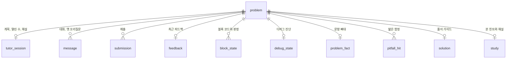

# store

SQLite 저장소다. 파일: `schema.py`(표, 버전), `codec.py`(계획·해설 JSON), `sqlite.py`(`Store`). 데이터 전체의 그림은 [Docs/architecture/data.md](../../../Docs/architecture/data.md)에 있다.

튜터 그래프 안에서는 읽기를 `context/`가, 쓰기를 `save/`가 맡는다. 성공한 요청만 `save_success` 트랜잭션 하나로 넣는다. 문항 등록, 직접 풀기 코드, 제출, 학습 기록(본 힌트와 해설)은 `Tutor`(`main.py`)와 화면 서버가 `Store`의 메서드로 직접 쓴다.

## 원칙

| 원칙 | 어떻게 |
| --- | --- |
| 기기에 DB 파일 하나 | 모든 문항이 한 파일에 있다. 서버 DB는 없다 |
| 문항끼리 섞이지 않음 | `setting`을 뺀 모든 표가 `problem_id`를 가진다. 블록 상태의 기본키는 (`problem_id`, `block_id`)라서 문항마다 `b1`이 따로다 |
| 고아 줄 없음 | `problem(id)` 외래 키, `ON DELETE CASCADE`, 연결마다 `PRAGMA foreign_keys=ON`. 문항을 지우면 그 문항의 줄이 같이 지워진다 |
| 요청 하나 = 트랜잭션 하나 | `save_success`가 한 트랜잭션으로 쓴다. 중간에 실패하면 모두 되돌린다. 오류로 끝난 요청은 아예 부르지 않는다 |
| 계획이 바뀌면 블록 상태를 지움 | 새 계획을 저장하는 트랜잭션에서 그 문항의 `block_state`를 지운다. 블록 id는 계획마다 `b1`부터 다시 쓰기 때문이다 |
| 스키마 버전 | `PRAGMA user_version`과 `MIGRATIONS` 목록. 지금 버전은 12다. 앱이 열릴 때 남은 것만 차례로 돈다. 한 트랜잭션이고 쓰기 잠금(`BEGIN IMMEDIATE`)을 먼저 잡으므로, 두 연결이 새 파일을 동시에 열어도 한쪽만 옮긴다. 바꿀 때는 목록 뒤에 붙이고 앞의 것은 고치지 않는다 |

버전마다 더한 것:

| 버전 | 더한 것 |
| --- | --- |
| 1 | 기본 표(`setting`, `problem`, `tutor_session`, `message`, `feedback`, `submission`, `block_state`) |
| 2 | `message.move` 칸 |
| 3 | `debug_state`, `problem_fact`, `pitfall_hit` 표 |
| 4 | `problem_fact`의 `skills_json`, `size` 칸 |
| 5 | `solution` 표와 `tutor_session.solution_json` 칸 |
| 6 | `submission`의 `language`, `status`, `detail_json` 칸과 `study` 표 |
| 7 | `block_state.renames_json` 칸 |
| 8 | `block_state.verdict`에 `?`를 허용한다(SQLite는 CHECK를 바꾸지 못해 표를 새로 만들어 옮긴다) |
| 9 | `problem_fact`의 `level`, `tags_json` 칸 |
| 10 | `study`의 `help_first_at`, `help_after_reset_at`, `reset_at`, `hints_at_reset` 칸. 옛 행은 남은 대화·해설·힌트 기록으로 채운다 |
| 11 | `debug_state.trap` 칸(디버그 진단이 고른 언어 함정) |
| 12 | `message.parts_json` 칸(튜터 말의 칸. 옛 말은 NULL) |

## 표

| 표 | 키 | 담는 것 |
| --- | --- | --- |
| `setting` | `key` | 앱 설정 |
| `problem` | `id` | 제목, 언어, 본문, 직접 풀기 코드 |
| `tutor_session` | `problem_id` | `plan_json`(블록 계획 전체), `open_count`, `explain_json`, `solution_json`(사용자 방법으로 다시 짠 계획이 따르는 가이드) |
| `message` | `id` 자동 증가, 색인 (`problem_id`, `mode`, `thread`, `id`) | 모드, 스레드(`main`, `debug`, 또는 옛 꼬리질문의 `quote:<id>`. `quote:`는 읽기만 한다), 블록 위치, 역할, 글, 질문 유형(`move`, 튜터 말만) |
| `submission` | `id`, 색인 `problem_id` | 제출 코드, 통과 여부, 언어, 결과 종류(`status`), 세부(`detail_json`) |
| `feedback` | `problem_id` | 최근 제출의 피드백 |
| `block_state` | (`problem_id`, `block_id`) | 사용자가 낸 블록 코드, `code_hash`, 판정 `verdict`(`Y`/`N`/`?`), 빠진 신호 `miss`, 낸 횟수 `tries`, 그 블록이 이름 바꾸기 표에 더한 짝 `renames_json`(`[[내 이름, 계획 이름], …]`) |
| `debug_state` | `problem_id` | 디버그 진단(코드 해시, 종류, 줄, 원인, 고친 줄, 단계, 함정, 언어 함정) |
| `problem_fact` | `problem_id` | 문항 뼈대(명세, 패턴, 구현 기술, 입력 크기, 단계, 태그). 비슷한 문항 찾기와 등록한 문제 목록이 쓴다 |
| `pitfall_hit` | (`problem_id`, `pitfall`, `code_hash`) | 제출에서 밟은 함정 |
| `solution` | `problem_id` | 정석 풀이 가이드(방향, 단계, 정답 코드, 검증 여부, 단서) |
| `study` | `problem_id` | AI 없이 본 힌트 수, 해설을 처음 연 시각, 통과 전에 열었는지, 도움(튜터 기능·힌트·해설)을 처음 쓴 시각(`help_first_at`), 마지막 '처음부터' 시각(`reset_at`)과 그 뒤에 도움을 처음 쓴 시각(`help_after_reset_at`), 그때까지 본 힌트 수(`hints_at_reset`. 이번 풀이에서 본 힌트 = `hints_seen` − `hints_at_reset`). 학습 보고서가 도움 없이 푼 문제를 가린다 |

판정 `?`는 확인 전이라는 뜻이다. 앞 블록이 바뀌어 통과를 물린 블록, 다시 확인이 실패한 블록, 이어 돌려 통과하지 못한 채운 블록이 여기에 든다.

## 왜 이렇게 나눴나

- 블록 계획은 `plan_json` 하나로 둔다. 문제마다 한 번 만들어 통째로 읽고, 블록 필드(`checks`, `hints`)가 늘어도 기본값으로 옛 계획이 읽힌다. 블록마다 줄로 나누면 필드가 늘 때마다 `ALTER`가 필요하다.
- 사용자가 바꾸는 값(블록 코드, 판정)은 `block_state`로 나눈다. 블록 하나만 고치고, 같은 코드면 `code_hash`로 판정을 재사용해 모델을 부르지 않는다.
- 판정의 이유 글은 저장하지 않는다. 판정 기호와 번호만 둔다. 저장할 것이 적고 샐 글이 없다.

## 알려진 한계

- 최근 제출은 `rowid` 내림차순이다. 같은 초에 두 건이어도 나중에 넣은 행이 최근이다.
